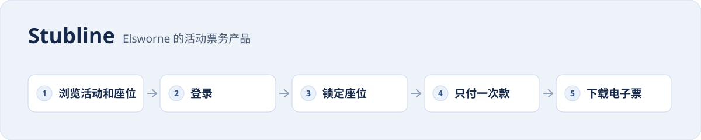

[English](README.md) · 简体中文

<picture>
  <source media="(prefers-color-scheme: dark)" srcset="card-zh-dark.svg">
  
</picture>

Stubline 是 Elsworne 的活动票务产品，也是《分布式系统》一书的仿真案例。买家浏览活动和座位，登录、锁座、只付一次款，然后下载电子票；团队要保证开售瞬间涌入成千上万名买家时，这条流程依然可用。

- **后端**：从一条网络连接上的单个服务开始，逐步拆成票务、库存和通知等独立服务，并加入数据库、消息、存放电子票的对象存储、服务之间的 TLS 与签名令牌、链路追踪，以及演练过的故障。
- **前端**：买家网站，从活动列表到下载电子票，包括登录和不会被重复扣款的支付。
- **技术探索**：团队在确定方案前做的短期实验，每个只回答一个问题。

## 动手试试

- [在 GitHub Codespaces 中打开后端](https://codespaces.new/codexary/stubline-backend)。使用量计入你自己的 GitHub 配额。
- [在浏览器中试用买家网站](https://codexary.github.io/stubline-web/)。演示使用模拟数据，无需后端。

## 仓库

| 仓库 | 类型 | 简介 |
| --- | --- | --- |
| [stubline-backend](https://github.com/codexary/stubline-backend) | 后端 | Stubline 活动票务后端：票务 API、库存服务（gRPC）、通知（Kafka outbox）、存放在 S3 的电子票、TLS/JWT、OpenTelemetry 与故障演练。Java 21。 |
| [stubline-web](https://github.com/codexary/stubline-web) | 前端 | Stubline 买家网站：浏览活动和座位，用 OAuth 2.0 + PKCE 登录，锁座，用幂等键只付一次款，下载电子票。React + TypeScript。 |
| [stubline-spike-dns-query](https://github.com/codexary/stubline-spike-dns-query) | 技术探索 | 手工构造并解析经 UDP 发送的 DNS 查询报文（A、CNAME、NXDOMAIN、超时）。 |
| [stubline-spike-resp-server](https://github.com/codexary/stubline-spike-resp-server) | 技术探索 | 一个最小的 RESP2 服务器，能与真正的 redis-cli 通信，用来理解 Redis 的线路协议。 |
| [stubline-spike-health-checker](https://github.com/codexary/stubline-spike-health-checker) | 技术探索 | 分别用平台线程、有界线程池和虚拟线程并发执行 HTTP 健康检查。 |
| [stubline-spike-rate-limiter](https://github.com/codexary/stubline-spike-rate-limiter) | 技术探索 | 令牌桶限流器，以及它的正确性如何取决于并发策略。 |
| [stubline-spike-fault-injection](https://github.com/codexary/stubline-spike-fault-injection) | 技术探索 | 用 Toxiproxy 注入延迟、带宽限制、超时和连接重置，观察客户端的截止时间。 |
| [stubline-spike-cgroup-memory](https://github.com/codexary/stubline-spike-cgroup-memory) | 技术探索 | JVM 堆上限与容器 cgroup 内存上限的关系，以及 OOM kill 的表现。 |
| [stubline-spike-spring-boot](https://github.com/codexary/stubline-spike-spring-boot) | 技术探索 | 用 Spring Boot 实现票务路由，看框架替你做了什么、又有什么无法替你决定。 |
| [stubline-spike-webhook-receiver](https://github.com/codexary/stubline-spike-webhook-receiver) | 技术探索 | 安全接收支付 webhook：HMAC 签名、重放时间窗和重复事件。 |
| [stubline-spike-rpc-styles](https://github.com/codexary/stubline-spike-rpc-styles) | 技术探索 | 同一个锁座服务分别用 Java RMI、gRPC 和 REST 实现。 |
| [stubline-spike-rabbitmq-tasks](https://github.com/codexary/stubline-spike-rabbitmq-tasks) | 技术探索 | 用 RabbitMQ 工作队列处理电子票渲染任务，包括确认机制和死信队列。 |
| [stubline-spike-redis-pubsub](https://github.com/codexary/stubline-spike-redis-pubsub) | 技术探索 | 比较 Redis pub/sub 与 Redis Streams 推送座位更新：迟到和慢速的订阅者、回放。 |
| [stubline-spike-nfs-cache](https://github.com/codexary/stubline-spike-nfs-cache) | 技术探索 | 两个客户端之间 NFSv3 与 NFSv4 的客户端缓存、close-to-open 一致性和写策略。 |
| [stubline-spike-dns-cache](https://github.com/codexary/stubline-spike-dns-cache) | 技术探索 | DNS 应答缓存在哪里（解析器、JVM、gRPC），过期的地址能存活多久。 |
| [stubline-spike-keycloak-oauth](https://github.com/codexary/stubline-spike-keycloak-oauth) | 技术探索 | Keycloak 配合 Spring Security：买家用授权码 + PKCE，服务之间用客户端凭证。 |
| [stubline-spike-kind-failover](https://github.com/codexary/stubline-spike-kind-failover) | 技术探索 | 在 kind 中丢失整个 Kubernetes 节点，与计划内的 drain 对比，统计失败的请求数。 |

> Elsworne、Stubline 和团队成员均为虚构。书和代码借助 AI 工具编写；书中引用的每一段输出都来自实际运行代码。
